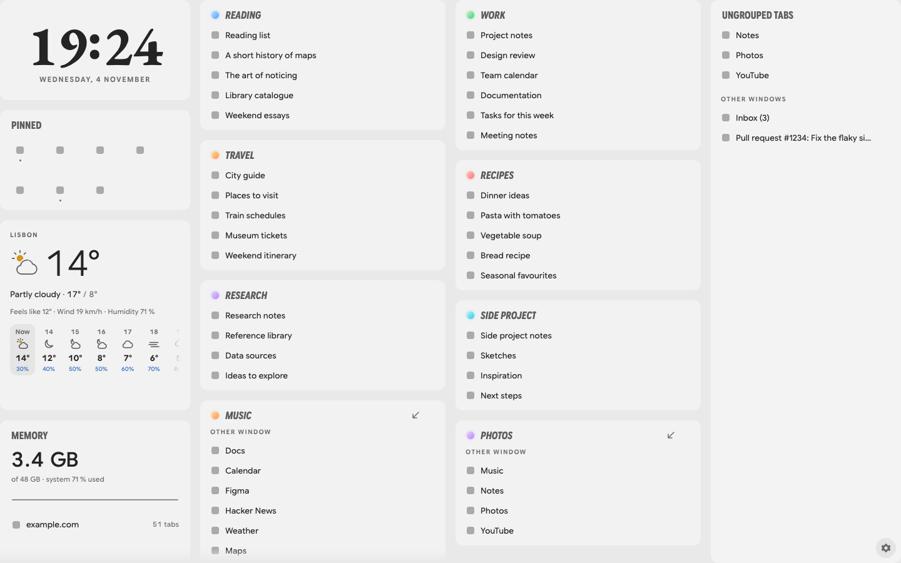

<div align="center">
  
  <h1>Foxy</h1>
  <p>Your tabs, groups, and widgets on one Firefox page.</p>
  <p>
    <a href="https://github.com/guru-irl/foxy/releases"></a>
    <a href="LICENSE"></a>
    
  </p>
</div>

Foxy replaces Firefox's new tab and home pages with a board of open tabs, groups, and widgets. It saves groups and pinned tabs as bookmarks, syncs them across devices, and can switch to an existing tab instead of opening a duplicate. It also includes a Firefox theme and a local helper for agents.

<picture>
  <source media="(prefers-color-scheme: dark)" srcset="docs/images/board-dark.png">
  
</picture>

Foxy supports desktop Firefox 140 or newer on macOS, Windows and Linux, not Android.

## Install

1. Download `foxy-<version>.xpi` from the [latest release](https://github.com/guru-irl/foxy/releases/latest).
2. Open about:addons, click the gear, choose **Install Add-on From File**, and pick the file.
3. Click **Keep changes** when Firefox asks about the new tab and home pages.

Foxy updates itself after that.

To remove Foxy, uninstall it in about:addons. Its bookmark folders remain until you delete them.

## Board

- Widgets are on the left, groups in the middle, and ungrouped tabs on the right. Each column scrolls independently. On narrow pages, widgets move above the groups.
- Drag either bar's inner edge to change its width. The default is 304 px, with a range from 240 px to one third of the page.
- Drag widgets or group headers to reorder them. Focus a group header and press Alt+Arrow to reorder it with the keyboard. Escape cancels a drag.
- Drag a widget's bottom edge to resize it. Group heights range from 2 to 40 rows. Double-click a group handle to fit 3 to 12 rows.
- The PINNED widget shows icons from all windows. Hover or focus to see a name, its window, and the close button. Arrow keys move between icons.
- SAVED lists closed groups. Open one with a click, or select × and then DELETE? to delete it everywhere.
- MEMORY shows Firefox and system memory and a five-minute graph. UNLOAD discards inactive, silent tabs by site. Per-site memory is unavailable. The helper is required.
- Weather shows a forecast for a chosen city or rounded location. Larger widgets show more detail. It refreshes every 15 minutes while visible and keeps the last reading offline.
- Click a tab to open it. Drag tabs between groups, ungrouped tabs, and pins. Drop a tab on empty group space to create a group.
- Rename a group by clicking its name, or change its colour by clicking its dot. The arrow brings another window's group here. The × closes it on this device.
- This window's groups appear first. Group order on the board does not change Firefox's tab order. Resizing the window does not save a layout.
- Picking a tab closes Foxy only when its page has no history, without adding it to Recently Closed.

## Settings

Open the gear on the board, or open Foxy's options in about:addons. Changes apply immediately. Escape or the gear closes the pane.

- Show or hide the clock, pins, saved groups, memory, and weather separately.
- Choose 12-hour or 24-hour time, with an optional date. Choose metric or imperial weather units and a city or your location.
- Set card transparency and normal 32 px or compact 24 px rows. Row density and location stay on this device.
- Show or hide other windows. Choose whether a pin from another window moves here or focuses its original window.
- Turn duplicate-tab switching on or off.
- Order, heights, and bar widths sync when Add-ons sync is enabled. Hidden widgets keep their order and height.
- Reset layout needs two clicks within 3 seconds. It resets order, heights, and bar widths without changing visibility or other settings.

## Pinned tab names

- The theme gives pins on about 30 sites short sidebar names, matched by title.
- F2 or right-click renames a pin. Enter saves and Escape cancels. The name is stored in its bookmark and syncs.
- Firefox asks once per site for access. On devices without access, a muted dot and ALLOW appear on the pin.
- Renamed pins replace page titles in windows and history, so unread counts in those titles are hidden.

## Duplicate tabs

- Foreground links for an already open page switch to that tab and close the new one. Foxy checks all windows, pins, and collapsed groups.
- Matches ignore URL fragments but respect containers and browsing mode. A collapsed group expands when its tab is selected.
- Foxy follows Safe Links and sign-in redirects for up to 2 minutes. A page must stay loaded for 3 seconds. Later clicks in that tab are not switched.
- Background tabs, popups, Foxy-opened tabs, session-restore bursts, and the first 15 seconds after startup are left alone.
- Closed duplicates do not enter Recently Closed. Reopening a tab with Ctrl+Shift+T can still switch to an existing copy and lose the reopened tab's history.

## Saved groups and Sync

- `Other Bookmarks/Foxy` contains the pinned folder and group folders, such as `🔵 Reading`.
- Closing a group or window keeps the group saved. Closing one tab removes its bookmark after 2 seconds.
- SAVED lists groups closed on this device. `N CAN'T REOPEN` counts blocked pages, such as `about:` and `file:` URLs.
- After a restart, a banner offers to restore missing groups or dismiss them. Pins reopen automatically.
- Changes from other devices apply live, except to the tab you are viewing. That tab updates after you switch away.
- Rename bookmark folders to rename groups, or add and move bookmarks to change tabs. First-run duplicates stay in `Other Bookmarks/Foxy merge leftovers`.
- Incognito windows are not shown or synced.

## Permissions and privacy

| Permission | Purpose |
|---|---|
| `tabs` | Read, open, move, pin, and close tabs |
| `tabGroups` | Read and manage groups |
| `bookmarks` | Save groups and pins |
| `storage` | Store mappings, pending changes, layouts, and settings |
| `scripting` | Keep a renamed pin's title |
| `nativeMessaging` | Connect the local helper for agents and MEMORY |
| `geolocation` (optional) | Use your location for weather |
| Location data collection (optional) | Allow weather requests |
| Site access (optional) | Rename a pin on that site |

Foxy collects no data. Weather requests go to Open-Meteo and BigDataCloud only after **Allow weather**. Location coordinates are rounded to two decimals before requests. A searched city does not need geolocation permission. Revoking location data consent removes the cached forecast and place name. When weather uses your location, revoking geolocation removes them too. Weather needs no API key, account, or cookies.

## Limits

- Firefox Sync controls timing, which can range from seconds to minutes.
- Bookmarks save URLs and titles, not back and forward history.
- Ungrouped, unpinned tabs are not saved.

## Agents

The local helper lets agents list and manage groups in a running Firefox. It supports macOS and Linux, needs Python 3, and uses no packages. The helper also powers MEMORY using macOS physical footprint or Linux PSS, with RSS as a fallback. Windows has no helper memory measurement.

| Helper commands | Minimum Foxy version |
|---|---|
| List and manage groups | 3.2.0 |
| Remove and delete | 3.4.0 |

Install it once from this repository, and keep the repository in place:

```sh
python3 scripts/install_agent.py
ln -s "$PWD/skills/foxy-tabs" ~/.agents/skills/foxy-tabs
```

```sh
agent/foxy groups
agent/foxy tabs "Read later"
agent/foxy add "Read later" https://example.com/review
agent/foxy new "Side project" http://localhost:3000 --color blue
agent/foxy add "Research" https://example.com/article --create
agent/foxy remove "Read later" https://example.com/review
agent/foxy delete "Old work" --close-tabs
```

Tabs open in the background. Adding to a saved group adds bookmarks without opening it. Missing groups are refused unless `--create` is used. Active tabs cannot be closed, and a group open on another device may reappear. Commands accept `--json` and exit with 0 for success, 1 for refusal, or 2 when Foxy is unreachable.

The helper runs from this repository. Update it with `git pull` before installing a newer Foxy. An older helper may show "Memory unavailable". To remove it, run `python3 scripts/install_agent.py --uninstall`.

## Theme

The theme is macOS-first. Glass blur works only on macOS. `theme/userChrome.css` styles the window, `theme/userContent.css` styles content pages, and `theme/user.js` sets preferences.

Quit Firefox and run `python3 scripts/install_theme.py`. The default is the macOS profile. Use `--profile PATH` or `--firefox-dir PATH` elsewhere. Existing files are backed up in `<profile>/chrome/backup-<time>/`. The installed files link to this repository, so keep it in place. Restart Firefox after theme changes.

To undo the install, quit Firefox, delete the four links, and restore the backup. Put `user.js` in the profile folder and the other files in `chrome/`.

## Develop

The add-on is in `extension/`. No npm packages are required. Headless runs use throwaway profiles under `.spider/scratch/`.

- `npm test` runs Node and Python tests.
- `npm run test:browser` runs DOM tests in headless Firefox.
- `npm run test:smoke` tests the add-on and duplicate-tab switching in headless Firefox.
- `python3 scripts/smoke_agent.py` tests the agent CLI and memory with a disposable native manifest.
- `python3 scripts/preview.py` creates offline previews in `dist/preview/`.
- `python3 scripts/preview_v40.py` regenerates the two README images.
- `python3 scripts/check_private.py` is an optional local pre-push check. It reads a pattern file kept outside this repository.
- See the [release guide](docs/releasing.md) for publishing a release.
- Design notes: [`docs/design/`](docs/design/).

## Credits

- [Liquid Fox](https://github.com/miloszfalinski/liquid-fox) by Milosz Falinski is the basis of the theme.
- Google Sans Flex, Cascadia Mono, and EB Garamond are distributed under the SIL Open Font License 1.1. Their licence files are in `extension/fonts/`.
- Weather data comes from [Open-Meteo](https://open-meteo.com/) and [BigDataCloud](https://www.bigdatacloud.com/).

## Licence

Foxy is MIT ([LICENSE](LICENSE)). Third-party licences:

- Liquid Fox theme: [MIT](theme/LICENSE), by [Milosz Falinski](https://github.com/miloszfalinski/liquid-fox).
- Google Sans Flex: [OFL 1.1](extension/fonts/GoogleSansFlex-OFL.txt) and [trademark notice](extension/fonts/GoogleSansFlex-TRADEMARKS.md).
- Cascadia Mono: [OFL 1.1](extension/fonts/CascadiaMono-OFL.txt).
- EB Garamond: [OFL 1.1](extension/fonts/EBGaramond-OFL.txt).

The same fonts and licences also ship in `theme/fonts/`.
